## 1. Импорт проекта

Поменяла Makefile:

```
export ENV_DESIGN = processing_unit
export ENV_FLOORPLAN_FILE = $(ENV_DESIGN_DIR)/floorplan/processing_unit.fp
```

```
module load cadence/INNOVUS/21.14
module load cadence/GENUS/21.14

make innovus
```

В консоли Innovus:
```
source $::env(FLOW_DIR)/steps.innovus.tcl
user_init_design
```

Посыпалось куча ворнингов.

1. IMPLF-200 - отсутствует ANTENNAGATEAREA

Он используется для проверки antenna violations - нарушений, которые могут возникать при изготовлении металлических межсоединений. Это важно для последующей трассировки и antenna checks. Но мы тут routing не делаем так что пофигу.

2. IMPVL-159 - VDD/VSS есть в LEF, но отсутствуют в Liberty

В LEF определён физический пин VDD, а в загруженной Liberty Innovus не нашёл соответствующего описания пина. И что я с этим сделаю? Видимо специфика PDK.

3. IMPEXT-2773 - отсутствует сопротивление VIA между M0 и M1

Innovus не нашёл сопротивление перехода между металлическими слоями. Поэтому он использует значение по умолчанию. Мы тут не делаем трассировку и анализ задержек межсоединений, так что пофигу.

4. IMPEXT-2776 - сопротивления VIA берутся из LEF

Сопротивления есть в Technology LEF, но отсутствуют в capacitance table. Что бы это ни значило. Видимо специфика PDK.

### 2. Создание floorplan

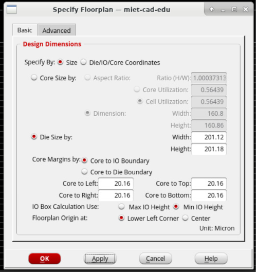

### 3. Размещение сигнальных пинов

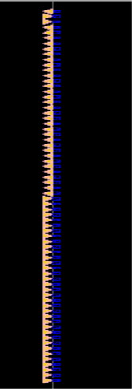

### 4. Создание кольца питания

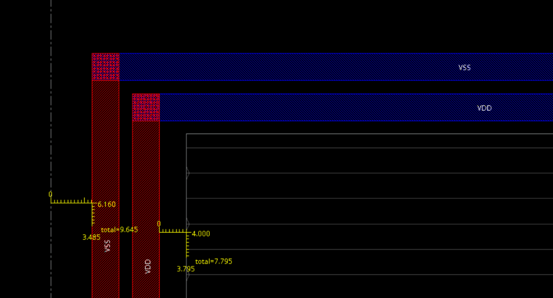

### 5. Создание шин питания вдоль rows

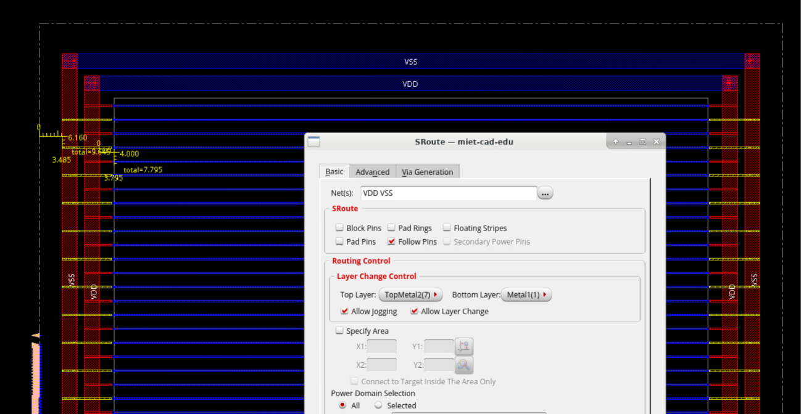

### 6. Создание периферийного placement blockage

У меня расстояние от die до внутренней стороны VDD - 16,16 мкм.

```
get_db current_design .bbox
```
> {0.0 0.0 201.12 201.18}

x0, y0 = (0, 201.18)
x1, y1 = (201.12, 0)

| Область | Нижний левый угол (X, Y) | Верхний правый угол (X, Y) |
|---|---|---|
| Левая | `0.0 0.0` | `16.16 201.18` |
| Правая | `184.96 0.0` | `201.12 201.18` |
| Нижняя | `16.16 0.0` | `184.96 16.16` |
| Верхняя | `16.16 185.02` | `184.96 201.18` |

```
create_place_blockage -rects {{0.0 0.0 16.16 201.18}} -type hard -no_cut_by_core
create_place_blockage -rects {{184.96 0.0 201.12 201.18}} -type hard -no_cut_by_core
create_place_blockage -rects {{16.16 0.0 184.96 16.16}} -type hard -no_cut_by_core
create_place_blockage -rects {{16.16 185.02 184.96 201.18}} -type hard -no_cut_by_core
```

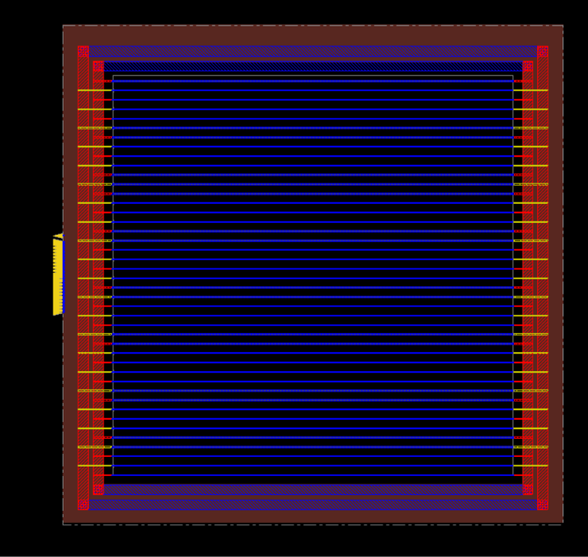

# На пять

## 1. Рассчитайте размеры floorplan
Используйте площадь стандартных ячеек из отчёта лабораторной работы №2 и методику раздела 4.3 «Площадь и плотность: пояснение и расчёт».

1. Определите площадь ячеек.

A_cells = 14_593 мкм² - суммарная площадь стандартных ячеек

2. Рассчитайте площадь core для плотности 50%.

A_core = A_cells / 0.5 = 29_186

3. Рассчитайте размеры квадратного core.

W_core = H_core = A_core**0.5 = 170.84

4. Выберите отступы между core и die.

Примите одинаковый отступ d с четырёх сторон. d = 15

5. Рассчитайте размеры die с учётом минимального размера 200 мкм.

W_die = 200.84

H_die = 200.84

6. Уточните размеры core и фактическую плотность.

При сохранении выбранных отступов итоговые размеры core составят:

W_core_final = 200.84 - 15*2 = 170.84

H_core_final = 200.84 - 15*2 = 170.84

Фактическая плотность:

U_core = 14_593 / 170.84**2 = 0.499994

7. Задайте рассчитанную геометрию в Innovus.

Используйте явные размеры, а не подбор Cell Utilization. Проверьте фактические размеры после привязки к сетке site и rows.

До apply:

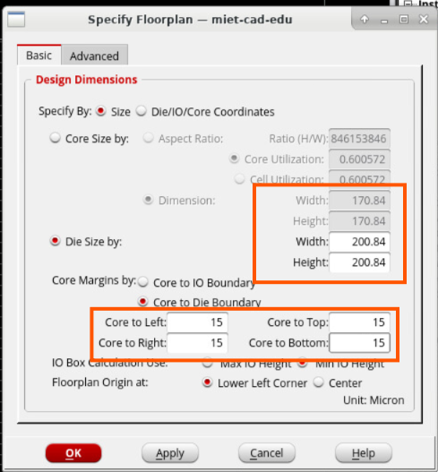

После:

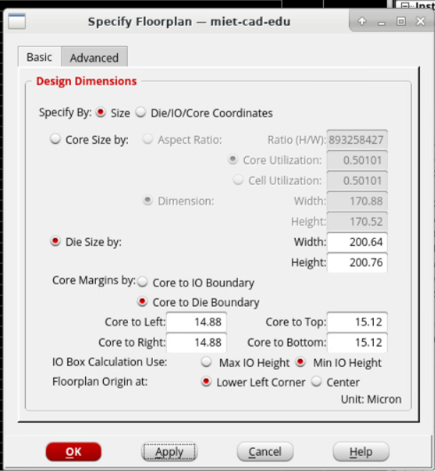

В конце расчёта укажите итоговую рассчитанную плотность заполнения core в процентах, используя фактические размеры из Innovus.

50.1% плотность.

## 2. Разместите сигнальные пины

Clk:

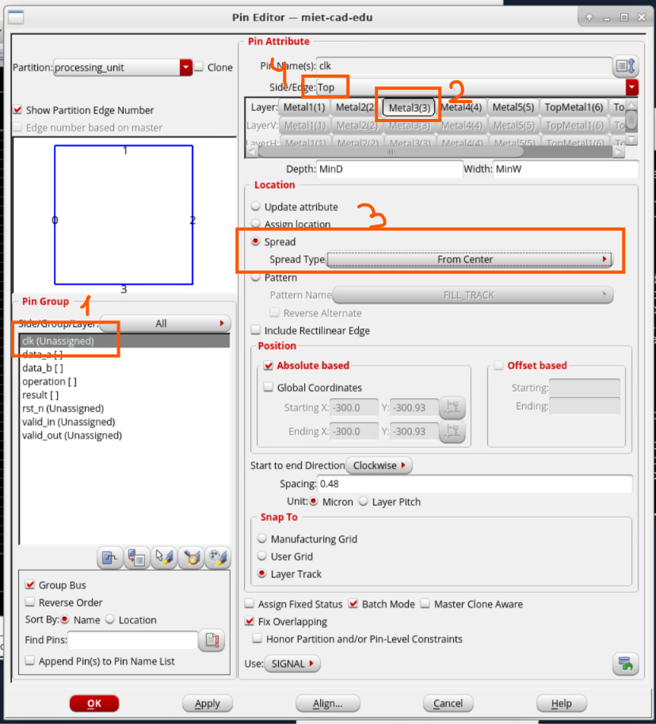

Входы.
Центральные 30% левой стороны: 0.35 * 200.76 = 70.266, 0.65 * 200.76 = 130.494

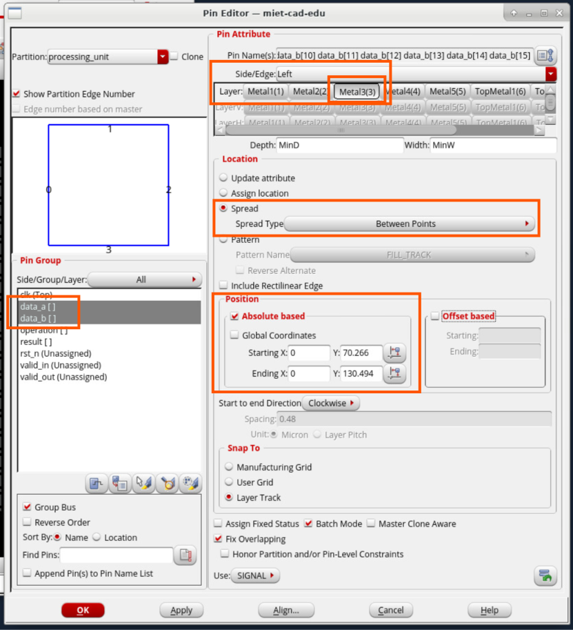

Выходы.
От 10 до 90% правой стороны: 0.1 * 200.76 = 20.076, 0.9 * 200.76 = 180.684

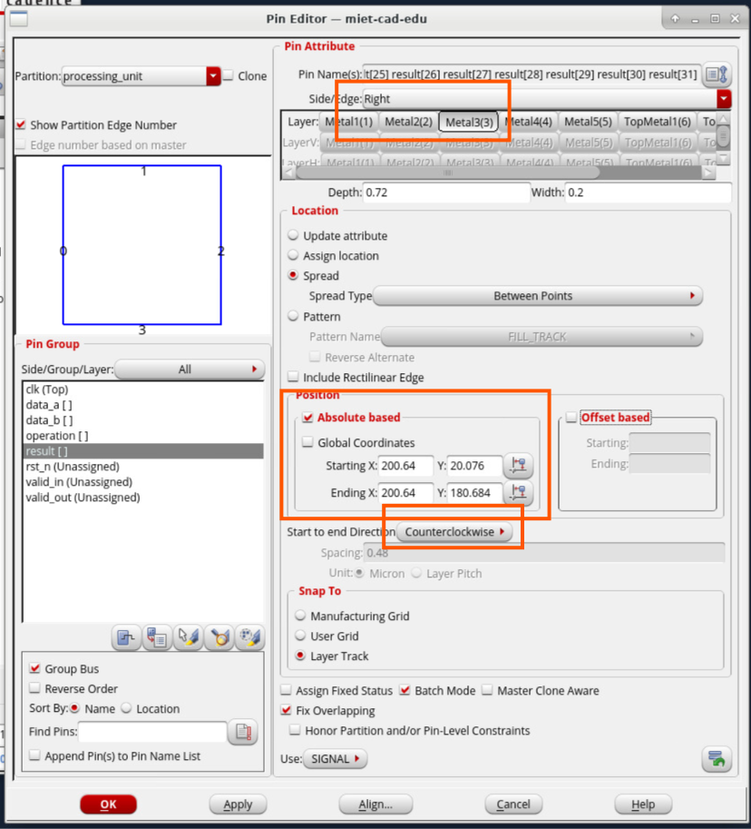

Управляющие сигналы.

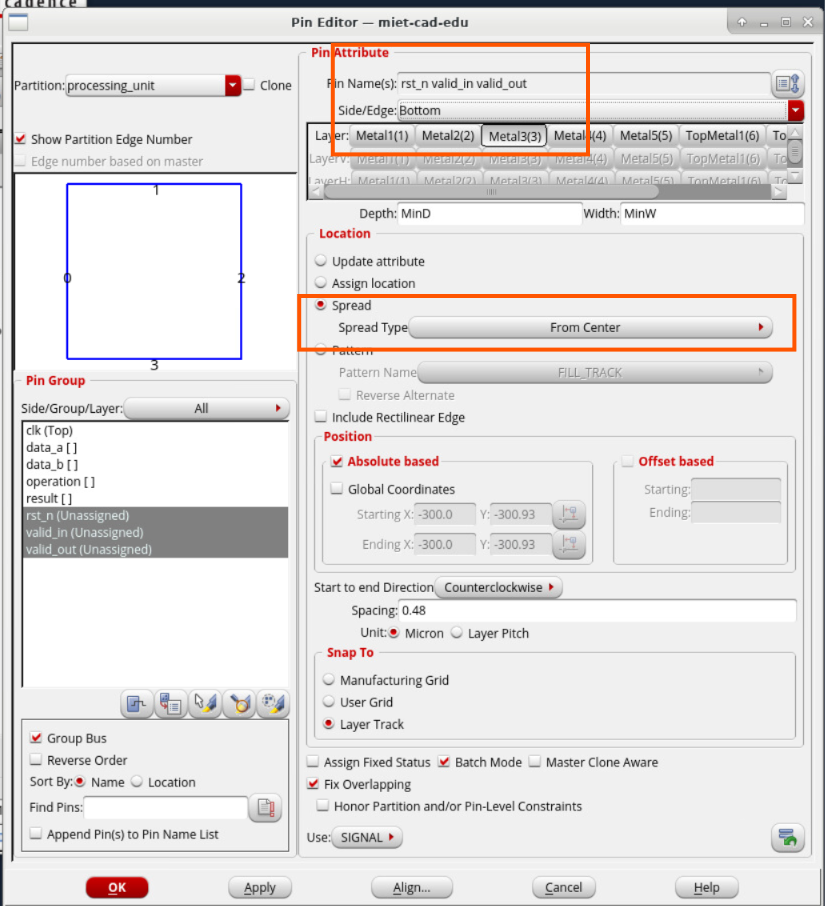

## 3. Создайте кольца питания

L = min(W, H) = 200.64

w = 0.02 * 200.64 = 4.01
s = 0.01 * 200.64 = 2.01
o = 0.02 * 200.64 = 4.01

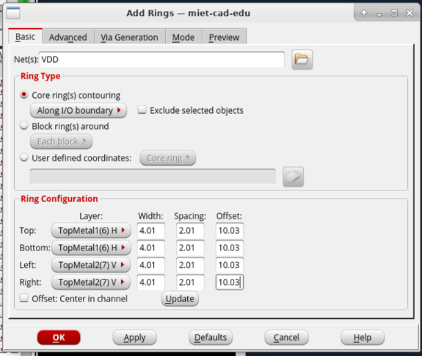

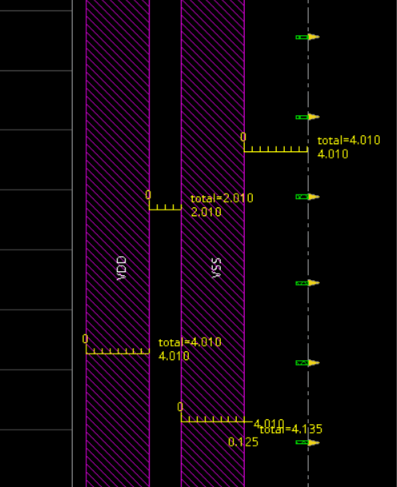

vias присутствуют автоматически:

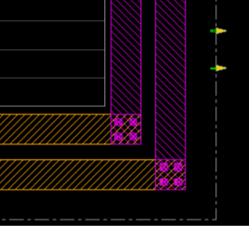

Я тут в моменте поняла, что не в том порядке VDD и VSS поставила, поменяла:

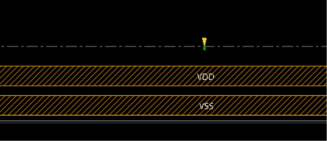

## 4. Добавьте центральные проводники питания

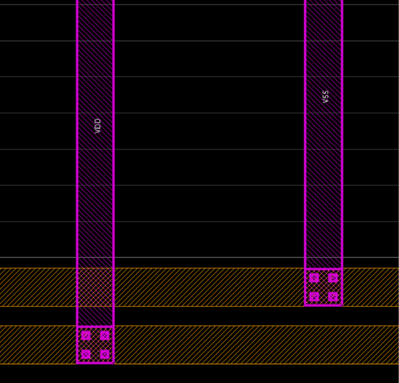

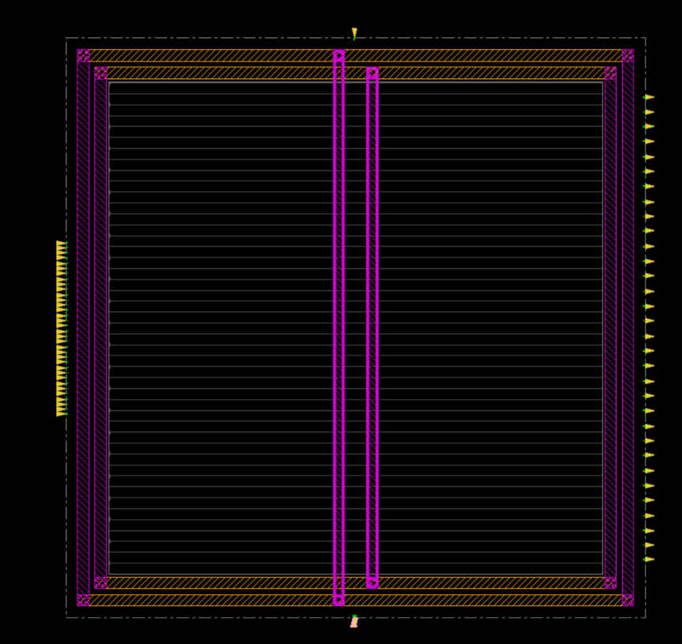

## 5. Вырежьте периферийные участки rows

t = o + 2w + s + a = 16.04

```
@innovus 204> split_row -area 0 0 16.04 200.76
@innovus 205> split_row -area 184.60 0 200.64 200.76
@innovus 206> split_row -area 16.04 0 184.60 16.04
@innovus 207> split_row -area 16.04 184.72 184.60 200.76
```

> После вырезания проверьте, что rows сохранились внутри кольца, а зазор до его внутреннего края составляет не менее 2 мкм.

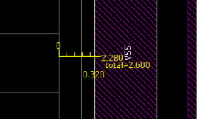

??? Оно?

## 6. Создайте дополнительные blockages

| Объект | Точка | X, мкм | Y, мкм |
|---|---|---:|---:|
| Hard placement blockage | A — нижний левый угол | 40.13 | 114.43 |
| Hard placement blockage | B — верхний правый угол | 72.23 | 148.56 |
| Routing blockage | C — нижний левый угол | 130.42 | 54.21 |
| Routing blockage | D — верхний правый угол | 162.52 | 88.33 |

Сначала нарисовала наобум, потом отредачила атрибуты:

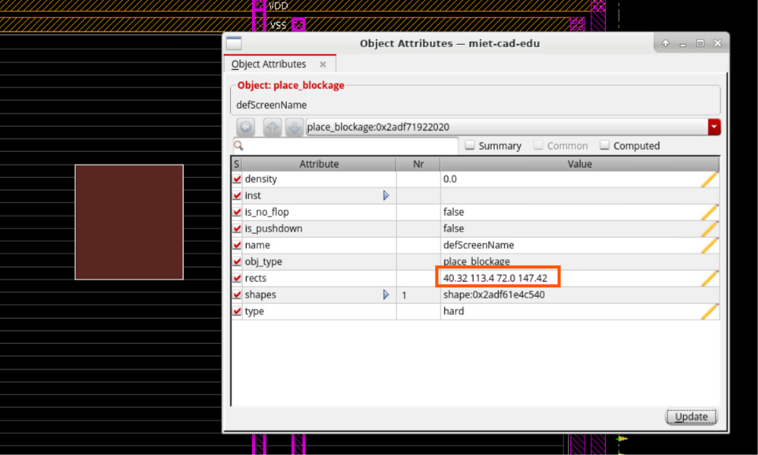

У Routing нельзя менять атрибуты(

Поэтому сначала наобум, потом стырила команду, удалила и написала правильно:
```
create_route_blockage -area 129.03900 37.70800 166.52500 80.39200
```

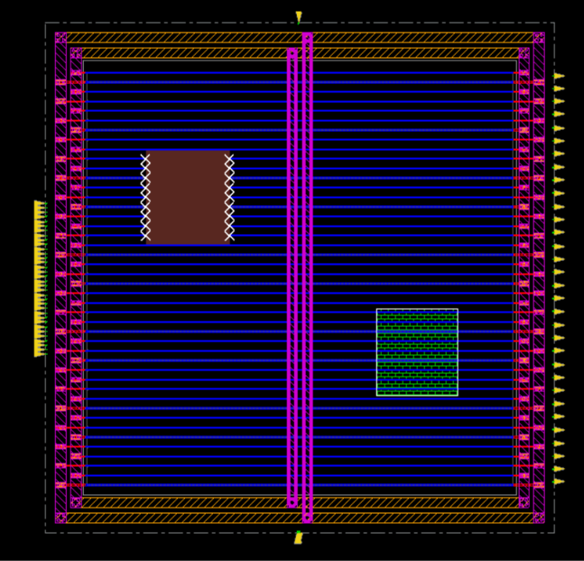

Для запуска скриптов:
```
source ../../flow_scripts/floorplan_4.tcl
source ../../flow_scripts/floorplan_5.tcl
```
