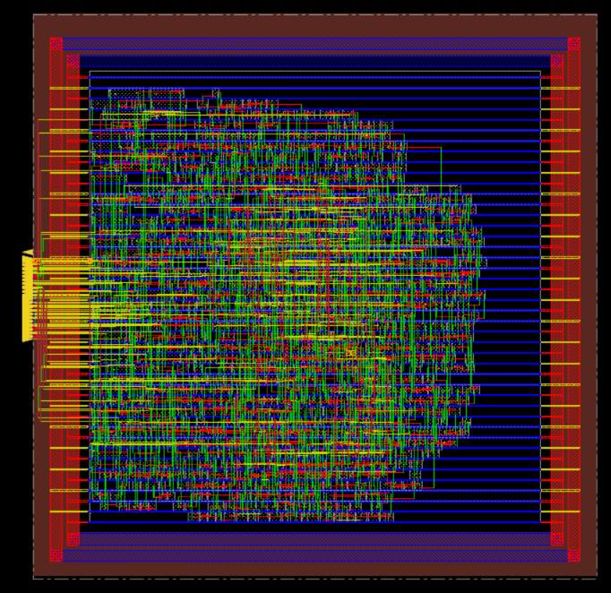
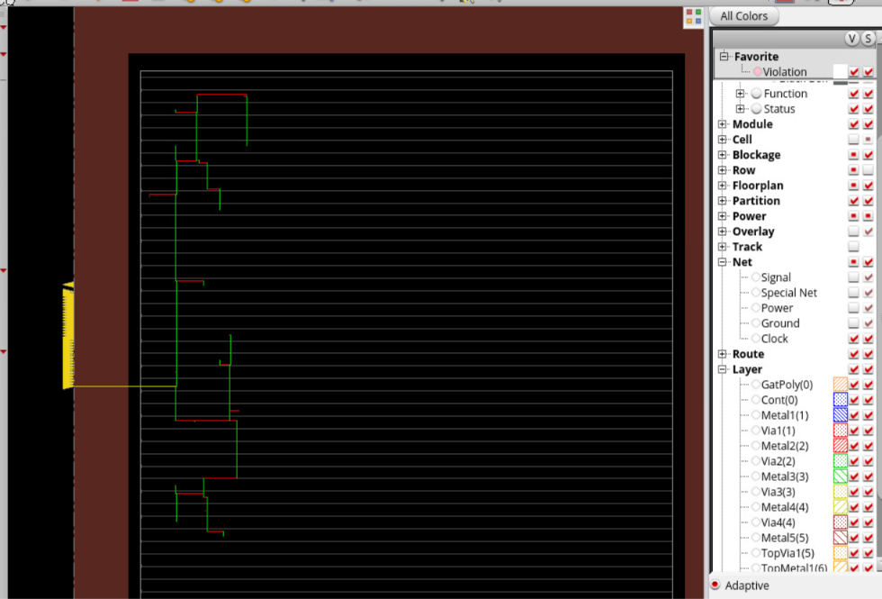
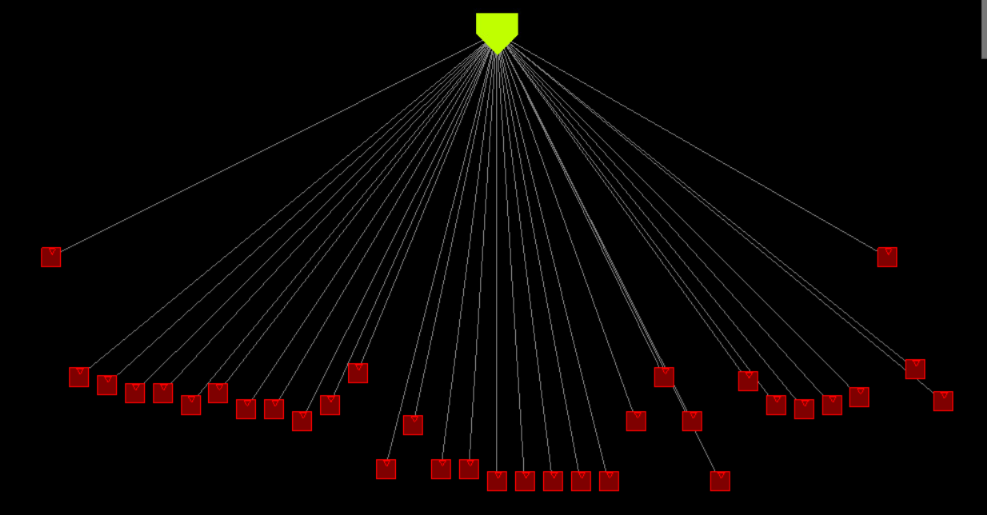

Запускаю Innovus:
```
make innvous
```

Затем подгрузка скрипта:
```
source $::env(FLOW_DIR)/steps.innovus.tcl
```

После чего базовая настройка и подгрузка floorplan:
```
user_init_design
global_net
user_read_floorplan
```

После чего начинаю играться с окружением, в лабе попросили сделать check_timing, делаю:
```
check_timing -verbose
```

Получаю на выходе ничего интересного.

Placement:
```
user_preplace
```

Эта команда я так понимаю просто репорты пишет, заодно еще подчищает все буферы с помощью `delete_buffer_trees` (а они там были?)
```
*summary: 69 instances (buffers/inverters) removed
```

Видимо были

Получила какие-то ворнинги:
```
**WARN: (IMPDB-2136):	Input term 'RESET_B' of  instance 'result_ff_reg[31]' does not connect to a 'TieHi ' net. The netlist is not correct or the net for connecting tie high/low signals is not specified. To resolve this problem, check your netlist or run connect_global_net to specify the tie high/low signal nets.
```
Хз что с этим делать

А еще:
```
Warning:
  There are 2 power/gnd nets that are not connected
```

Я выполняла `global_net`, так что тоже без понятия откуда такие ворнинги.

Короче ничего не понятно, делаю дальше:
```
user_place
```

Получила красоту:


```
report_congestion -overflow
```

> Usage: (12.2%H 9.3%V) = (2.378e+04um 1.647e+04um) = (6291 4356)
> Overflow: 0 = 0 (0.00% H) + 0 (0.00% V)
>
> Congestion distribution:
>
> Remain	cntH		cntV
> --------------------------------------
> --------------------------------------
>   1:	1	 0.04%	0	 0.00%
>   2:	5	 0.18%	1	 0.04%
>   3:	2	 0.07%	0	 0.00%
>   4:	6	 0.21%	3	 0.11%
>   5:	2795	99.50%	2805	99.86%

Вроде по кайфу всё, использование горизонтальных ресурсов составляет 12.2%, вертикальных — 9.3%. Overflow равно нулю в обоих направлениях

```
time_design -pre_cts
```
Показал положительные slack, продолжаем

```
user_clock_tree_synthesis
```

Выбрала показывать только клок в Net, результат какой-то... странный...


Запустила репорт для холда и сетапа, там все ок, но есть вот такое:
```
+----------------+-------------------------------+------------------+
|                |              Real             |       Total      |
|    DRVs        +------------------+------------+------------------|
|                |  Nr nets(terms)  | Worst Vio  |  Nr nets(terms)  |
+----------------+------------------+------------+------------------+
|   max_cap      |      0 (0)       |   0.000    |      0 (0)       |
|   max_tran     |      0 (0)       |   0.000    |      0 (0)       |
|   max_fanout   |     28 (28)      |    -24     |     28 (28)      |
|   max_length   |      0 (0)       |     0      |      0 (0)       |
+----------------+------------------+------------+------------------+
```

Выглядит грустно, но мы продолжаем

Вообще в логе еще такое было:
> Warning: clock_opt_design requires beta feature
> innovusClockOptFlow enabled.

Поменяла в скрипте `clock_opt_design` на `ccopt_design`



Далее делаю
```
user_route
user_extract_rc
user_sta
```

> +--------------------+---------+---------+---------+
> |     Hold mode      |   all   | reg2reg | default |
> +--------------------+---------+---------+---------+
> |           WNS (ns):|  0.098  |  0.364  |  0.098  |
> |           TNS (ns):|  0.000  |  0.000  |  0.000  |
> |    Violating Paths:|    0    |    0    |    0    |
> |          All Paths:|   66    |   32    |   66    |
> +--------------------+---------+---------+---------+
> |typ                 |  0.098  |  0.364  |  0.098  |
> |                    |  0.000  |  0.000  |  0.000  |
> |                    |    0    |    0    |    0    |
> |                    |   66    |   32    |   66    |
> +--------------------+---------+---------+---------+

Опять все по кайфу, считаю лабу сделанной

P.S. При повторном вызове `global_net` добавлялись новые подключения, поэтому я на всякий продублировала этот вызов после этапов меняющих что-либо в дизайне
